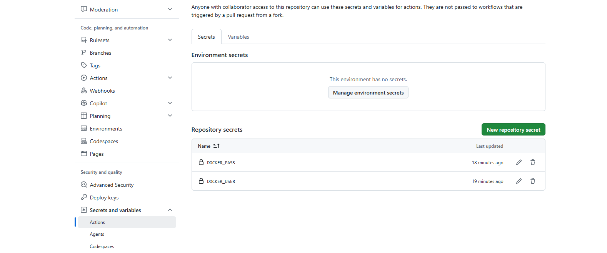

## День 1: Плохой пайплайн (Bad Practices)

После того, как мы ввели секреты в GithubActions, написалм bad practices.yml.



```yml
name: Bad Pipeline 
on: [push]

jobs:
  build-and-deploy:
    runs-on: ubuntu-latest
    steps:
      - name: Checkout code
        uses: actions/checkout@v2 

      - name: Build Docker image
        run: |
          docker build -t ${{ secrets.DOCKER_USER }}/notes-backend:latest -f backend/dockerfile.good_backend ./backend
          
      - name: Login to Docker Hub
        run: |
          echo "${{ secrets.DOCKER_PASS }}" | docker login -u "${{ secrets.DOCKER_USER }}" --password-stdin          
          
      - name: Push image
        run: docker push ${{ secrets.DOCKER_USER }}/notes-backend:latest
        
      - name: Deploy
        run: |
          docker compose up -d

```
Что здесь плохого?
1) Мы наняли стажера из 2019 года (потрясная строчка actions/checkout@v2)
actions/checkout по идее скачивает код из репо на виртуальную машину, где выполняется пайплайн. @v2 вышла в 2019 году. Это свежая-готовая дверь для злоумышленника, т.к. можно теоретически сделать нехороший коммит, поставить тег @v2 на него и запустить код. Ну и плюсом все эти приколы-уязвимости, которые устранили в новых версиях все еще портят жизнь в старой.

2) Мы сожгли мосты (/notes-backend:latest)
Ура ура, с этим чудом каждая ошибка будет финальной, ибо с ней откатиться не получится. Пусть мы изменили код и все, как обычно, сломали. И запушили. Старый образ с тегом :latest этим перезаписывается. Вернуться назад невозможно, потому что теперь у нас ТОЛЬКО ОДИН образ :latest. Прощайте, принципы гитхаба, нам на вас плевать.

3) Мы точно решили, что все будет хорошо (docker compose up -d)
Контейнер запускается в фоновом режиме, и все глубоко фиолетово, что там дальше с ним произойдет. Пусть вылезет хоть 200 ошибок, мы все равно покрасим флажок на Гите в зеленый, т.к. мы верим в добро и чудо. И в то, чтобы бедный разраб в пятницу вечером не страдал дополнительно. Пайплайн завершиться не проверив, были ли ошибки в деплое.

4) Мы не хотим заморачиваться тестами. (docker build -t)
Отличная идея. Теперь если мы забудет точку с запятой в конце строчки то 1)Плохой пайплайн сразу начинает собирать Docker-образ. И не важно, есть там ошибки или нет. 2) Docker успешно собирается! Пайплайн зеленый! Все счастливы! 3)Сервер запускает контейнер. Приложение пытается стартовать, натыкается на ошибку в коде и падает. Сайт лежит.

5) Мы не проверяем срок годности на йогурте (Trivy нет)
Т.к. нет сканера уязвимостей Trivy, то спокойно ставится какой-нибудь устаревший питон или какая-нибудь левая библиотека, сделаная на коленке в гараже 13-летним пацаном из Антарктиды. Дальше тот же пацан сканирует наши порты,эксплуатирует дырку в библиотеке, захватывает контейнер - и вуаля, теперь уже мы не пишем заметки, а майним крипту (гораздо более прибыльное дело). Или боремся за независимость Антарктиды от пингвинов. 

6) Мы слишком сильно любим лего. (Нет Кэша)
Да зачем нужен этот кэш pip, если можно каждый раз весело заниматься DIY? 
GitHub Actions создает чистую виртуальную машину при первом запуске пайплайна. Пайплайн выполняет pip install -r requirements.txt. Он качает 200 МБ из интернета. Это занимает 2 минуты. Нам позарез понадобилось добавить еще 1 комментарий, пайплайн пересобирается, и вот, GitHub Actions снова создает чистую машину. И снова качает те же 200 МБ. Опять 2 минуты.


